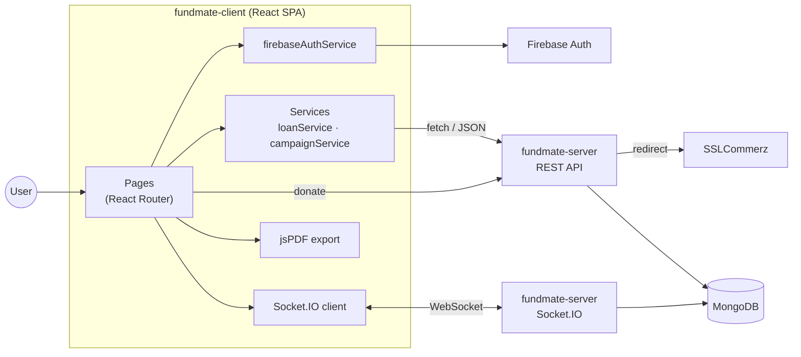
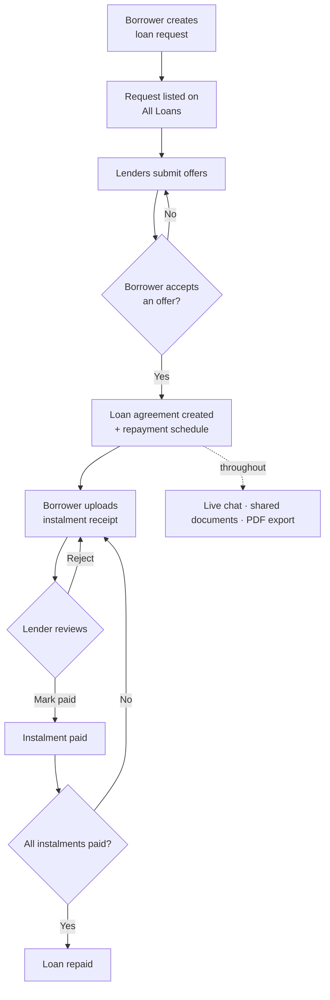
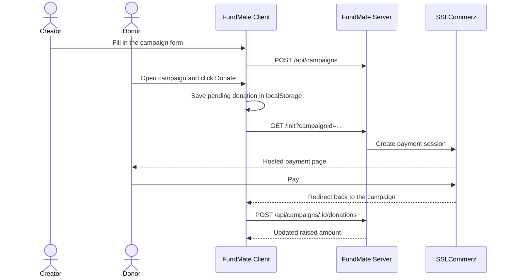

# FundMate Client

The public web app for **FundMate**, a peer-to-peer lending and crowdfunding platform. Borrowers post loan requests, lenders make offers, both sides manage the resulting agreement (repayments, documents and live chat), and anyone can start or support a crowdfunding campaign.


---

## Table of Contents

- [Part of the FundMate Platform](#part-of-the-fundmate-platform)
- [Features](#features)
- [Tech Stack](#tech-stack)
- [Architecture](#architecture)
- [User Flows](#user-flows)
- [Routes](#routes)
- [Getting Started](#getting-started)
- [Environment Variables](#environment-variables)
- [Project Structure](#project-structure)
- [Deployment](#deployment)
- [Author](#author)

---

## Part of the FundMate Platform

| Repository | Description |
| --- | --- |
| **fundmate-client** (this repo) | Public web app for borrowers, lenders, campaign creators and donors |
| [fundmate-admin](https://github.com/mahfuzhasanreza/fundmate-admin) | Admin dashboard for monitoring and moderating platform activity |
| [fundmate-server](https://github.com/mahfuzhasanreza/fundmate-server) | REST + Socket.IO backend shared by both front ends |

---

## Features

### Accounts
- Email/password sign-up and sign-in with **Firebase Authentication**
- One-click sign-in with **Google** or **GitHub**
- Optional **guest login** with a shared demo account, so visitors can try the app without registering

### Peer-to-peer loans
- Create a loan request with amount, purpose, tenure, interest rate, repayment schedule, collateral notes and supporting files
- Browse and filter all open loan posts
- Lenders submit offers with their own amount, rate and tenure
- Borrowers compare offers and accept one, which creates a loan agreement

### Loan agreements
- Generated **monthly repayment schedule** with due dates and status
- Upload a payment receipt for each instalment; the lender marks it paid or rejects it
- Shared document vault with **mutual-consent deletion**
- **Real-time chat** between borrower and lender over Socket.IO
- **Export the agreement to PDF** (jsPDF + AutoTable)

### Crowdfunding
- Create campaigns with category, target, duration, location, story, images, tags and urgency level
- Browse campaigns and track progress toward each goal
- Donate through the **SSLCommerz** payment gateway (sandbox)

### Experience
- Personal dashboard showing your loans, offers, agreements and campaigns
- In-app notification bell and toast messages
- Responsive, animated landing page built with Framer Motion

---

## Tech Stack

| Concern | Technology |
| --- | --- |
| UI library | React 18 |
| Build tool | Vite 5 |
| Styling | Tailwind CSS 3 |
| Routing | React Router 6 |
| Animation | Framer Motion |
| Icons | Lucide React |
| Authentication | Firebase Auth (+ `react-firebase-hooks`) |
| Real-time | `socket.io-client` |
| PDF export | jsPDF, jspdf-autotable |
| Hosting | Firebase Hosting |

---

## Architecture



Firebase handles identity only. All application data (loans, offers, agreements, campaigns, donations) is read from and written to the FundMate server.

---

## User Flows

### Loan: request → offer → agreement



### Crowdfunding: campaign → donation



---

## Routes

| Path | Page | Description |
| --- | --- | --- |
| `/` | `LandingPage` | Marketing landing page |
| `/login` | `Login` | Email, Google, GitHub or guest sign-in |
| `/register` | `Register` | Create an account |
| `/dashboard` | `Dashboard` | Your loans, offers, agreements and campaigns |
| `/loan-request` | `LoanRequest` | Create a loan request |
| `/all-loans` | `AllLoanPost` | Browse all loan requests |
| `/loan/:id` | `LoanDetails` | Loan details, offers and accepting an offer |
| `/agreement/:agreementId` | `LoanAgreement` | Repayments, documents, chat and PDF export |
| `/campaigns` | `Campaigns` | Browse campaigns |
| `/create-campaign` | `CampaignCreate` | Start a campaign |
| `/campaign/:id` | `CampaignDetails` | Campaign details and donating |
| `/success` | `PaymentSuccess` | Payment success page |
| `/fail`, `/cancel` | `PaymentFail` | Payment failed or cancelled page |

---

## Getting Started

### Prerequisites

- Node.js 18 or later
- A Firebase project with Email/Password, Google and GitHub sign-in enabled
- A running [fundmate-server](https://github.com/mahfuzhasanreza/fundmate-server) (local or deployed)

### Installation

```bash
git clone https://github.com/mahfuzhasanreza/fundmate-client.git
cd fundmate-client
npm install
```

Create a `.env` file (see below), then start the dev server:

```bash
npm run dev
```

The app opens at **http://localhost:3000**.

### Scripts

| Script | Description |
| --- | --- |
| `npm run dev` | Start the Vite dev server on port 3000 |
| `npm run build` | Build for production into `dist/` |
| `npm run preview` | Preview the production build locally |

---

## Environment Variables

Create `.env` in the project root:

```env
# FundMate API
VITE_API_BASE_URL=https://fundmate-server-six.vercel.app
VITE_SOCKET_URL=http://localhost:5000

# Firebase
VITE_FIREBASE_API_KEY=
VITE_FIREBASE_AUTH_DOMAIN=
VITE_FIREBASE_PROJECT_ID=
VITE_FIREBASE_STORAGE_BUCKET=
VITE_FIREBASE_MESSAGING_SENDER_ID=
VITE_FIREBASE_APP_ID=

# Guest / demo login (optional)
VITE_GUEST_EMAIL=
VITE_GUEST_PASSWORD=
```

| Variable | Default | Description |
| --- | --- | --- |
| `VITE_API_BASE_URL` | `https://fundmate-server-six.vercel.app` | Base URL of the REST API |
| `VITE_SOCKET_URL` | `http://localhost:5000` | Socket.IO server for agreement chat |
| `VITE_FIREBASE_*` | — | Firebase web app configuration |
| `VITE_GUEST_EMAIL` / `VITE_GUEST_PASSWORD` | — | Demo account; the guest button only appears when both are set |

> **Note:** Vite bundles every `VITE_*` variable into the client JavaScript, so these values are public. Only use a throwaway Firebase account for guest login, and never put server secrets here.

---

## Project Structure

```
fundmate-client/
├── public/
├── src/
│   ├── components/
│   │   ├── common/          # ToastProvider
│   │   ├── landing/         # Hero, Stats, Features, HowItWorks, Services,
│   │   │                    # FeaturedLoans, FeaturedCampaigns, FAQ, CallToAction
│   │   ├── layout/          # Navbar, Footer
│   │   ├── NotificationBell.jsx
│   │   ├── NotificationCenter.jsx
│   │   └── ToastContainer.jsx
│   ├── config/
│   │   ├── api.js           # API base URL
│   │   └── firebase.js      # Firebase initialisation
│   ├── hooks/
│   │   └── useNotifications.js
│   ├── pages/               # One component per route
│   ├── services/
│   │   ├── firebaseAuthService.js
│   │   ├── loanService.js
│   │   └── campaignService.js
│   ├── App.jsx              # Router and layout
│   ├── main.jsx
│   └── index.css
├── firebase.json            # Firebase Hosting config (SPA rewrites)
├── tailwind.config.js
├── vite.config.js
└── package.json
```

---

## Deployment

The app is set up for **Firebase Hosting**, with all routes rewritten to `index.html` for client-side routing.

```bash
npm run build
npm i -g firebase-tools
firebase login
firebase deploy --only hosting
```

Add your hosting domain to **Firebase Console → Authentication → Settings → Authorized domains** so that Google and GitHub sign-in work in production.

---

## Author

**Mahfuz Hasan Reza** – [@mahfuzhasanreza](https://github.com/mahfuzhasanreza)
